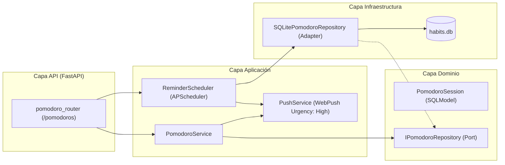
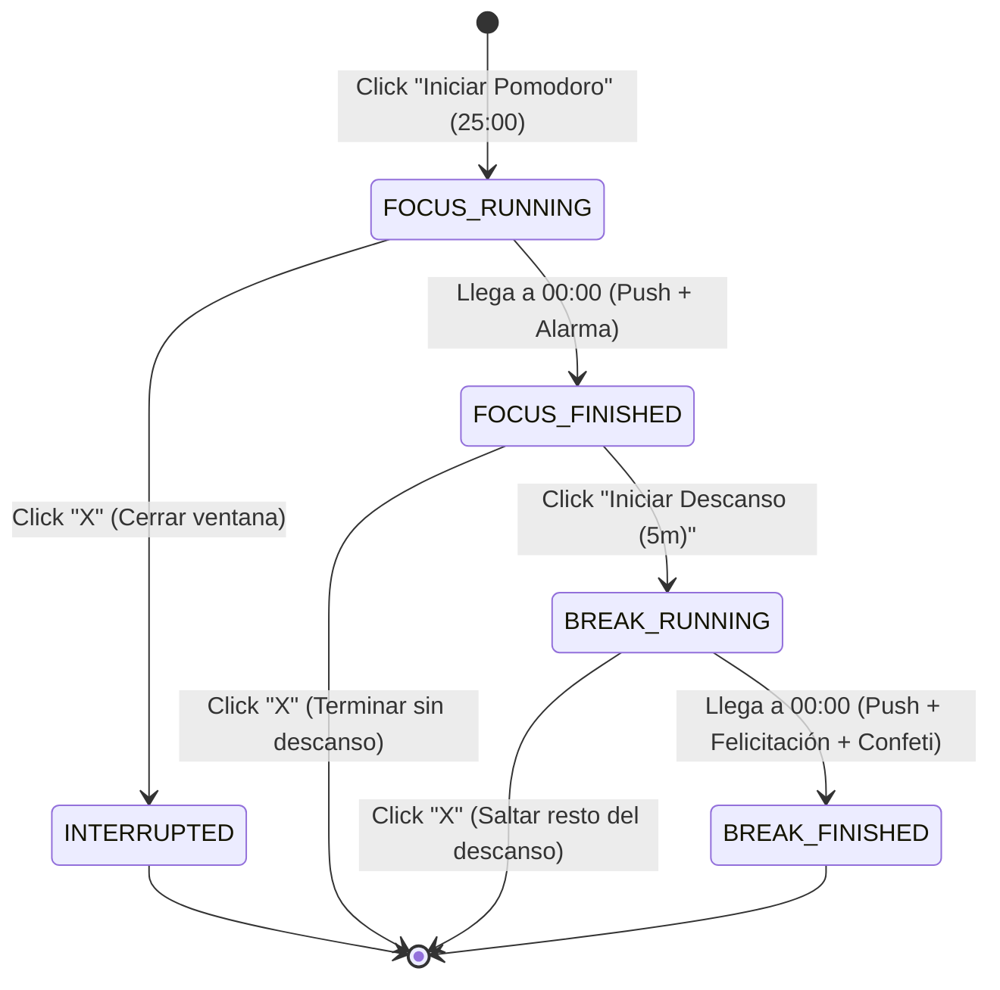

# Plan de Arquitectura, Diseño e Implementación: Funcionalidad Pomodoro

> [!IMPORTANT]
> Este documento está diseñado como una **especificación técnica paso a paso (Blueprint)** lista para ser ejecutada directamente por otro modelo sin ambigüedades, respetando estrictamente las convenciones de `GEMINI.md` (Arquitectura Hexagonal, SOLID, i18n, UI/UX Páramo, Sin controles nativos del OS y Cero Puntos Finales en copy corto).
> **REGLA ESTRICTA DE CÓDIGO:** Todo el código que se escriba durante la implementación (nombres de variables, funciones, métodos, clases, constantes, comentarios inline, docstrings, JSDoc y tests) debe estar **100% en inglés**.

---

## 1. Visión General y Reglas de Negocio

1. **Independencia de Tareas (Aditiva):**
   - Los Pomodoros **NO están atados a tarjetas/tareas**, sino exclusivamente a la dimensión temporal (fecha, hora, minuto, segundo, día, mes, año) y al contexto de ejecución (dispositivo).
   - El temporizador propio de las tareas diarias (`duration_minutes` / botón Play en `frontend/src/components/TaskCard.jsx`) **se mantiene intacto**.
   - **Exclusión mutua de timers:** Al abrir el `PomodoroPanel` o al disparar un Pomodoro, si existe una tarea con timer en curso (`activeTimer.taskId`), la aplicación lo detiene automáticamente (`stopTimer(true)`) para garantizar que nunca existan dos cronómetros corriendo simultáneamente.

2. **Tiempos Fijos (No configurables):**
   - **Focus Time:** `25 minutos` (`1500 segundos`).
   - **Descanso Corto (Break Time):** `5 minutos` (`300 segundos`).
   - No existe configuración de duración ni descanso largo; los pomodoros se disparan *on-demand*.

3. **Ciclo de Vida y Estados para Analítica Futura:**
   - **`IN_PROGRESS`:** Se crea el registro en BD cuando el usuario dispara el Pomodoro (Focus). Guarda `started_at` exacto (UTC), `date_str` (`YYYY-MM-DD` en la zona horaria IANA activa del usuario `user.timezone`, con fallback a `America/Bogota`), `hour_of_day` (`0-23` en hora local del usuario), y `device_type` (`mobile` | `desktop`).
   - **`COMPLETED`:** Apenas finalizan los 25 minutos de Focus (ya sea por el scheduler en background o por el reloj del frontend). El tiempo de descanso de 5 minutos es posterior y opcional; interrumpir o saltar el descanso **no** quita el estado `COMPLETED` del Pomodoro.
   - **`INTERRUPTED`:** Si el usuario cierra la ventana flotante (`X`) o detiene el Pomodoro antes de que finalicen los 25 minutos de Focus. Se registra `interrupted_at` (UTC) y `elapsed_focus_seconds`.
   - **Registro Manual (`is_manual = True`):** Se registra directamente como `COMPLETED` en la fecha local actual del usuario (`today`), pidiendo únicamente la **hora del día** (`00:00` a `23:00` en la zona horaria local del usuario, convirtiendo el instante exacto a UTC con minutos y segundos en `00:00`) mediante un `<Dropdown>` personalizado estilo Páramo, para alimentar sin sesgos las métricas futuras de franjas horarias más productivas.

---

## 2. Arquitectura del Backend (Hexagonal + SQLModel + APScheduler)



### 2.1. Modelo de Dominio (`backend/src/domain/models.py`)
Añadir los siguientes enums y modelos SQLModel:

```python
class PomodoroStatus(str, Enum):
    IN_PROGRESS = "in_progress"
    COMPLETED = "completed"
    INTERRUPTED = "interrupted"


class PomodoroPhase(str, Enum):
    FOCUS = "focus"
    BREAK = "break"
    DONE = "done"


class DeviceType(str, Enum):
    DESKTOP = "desktop"
    MOBILE = "mobile"


class PomodoroSession(SQLModel, table=True):
    __tablename__ = "pomodoro_session"
    id: Optional[int] = Field(default=None, primary_key=True)
    user_id: int = Field(index=True)
    status: PomodoroStatus = Field(default=PomodoroStatus.IN_PROGRESS, index=True)
    phase: PomodoroPhase = Field(default=PomodoroPhase.FOCUS)
    
    # Time dimensions for fast analytics queries (Local time America/Bogota UTC-5)
    date_str: str = Field(index=True)          # Format: "YYYY-MM-DD"
    year: int = Field(index=True)              # e.g., 2026
    month: int = Field(index=True)             # 1..12
    day: int = Field(index=True)               # 1..31
    hour_of_day: int = Field(index=True)       # 0..23 (time slot)
    
    # Exact UTC timestamps (for manual entries: minutes and seconds are set to 00)
    started_at: datetime = Field(default_factory=lambda: datetime.now(timezone.utc))
    completed_at: Optional[datetime] = Field(default=None)
    interrupted_at: Optional[datetime] = Field(default=None)
    
    # Durations and metadata
    focus_duration_minutes: int = Field(default=25)
    break_duration_minutes: int = Field(default=5)
    elapsed_focus_seconds: int = Field(default=0)
    is_manual: bool = Field(default=False, index=True)
    device_type: DeviceType = Field(default=DeviceType.DESKTOP)
    
    # Scheduler and Push notification control (Focus and Break phases)
    timer_end_time: Optional[datetime] = Field(default=None, index=True)
    notification_sent: bool = Field(default=False)
```

**Schemas de entrada/salida en `models.py`:**
- `PomodoroStartRequest(SQLModel)`: `device_type: DeviceType = DeviceType.DESKTOP`
- `PomodoroManualCreate(SQLModel)`: `hour_of_day: int = Field(ge=0, le=23)`, `device_type: DeviceType = DeviceType.DESKTOP`
- `PomodoroInterruptRequest(SQLModel)`: `elapsed_seconds: Optional[int] = None`
- `PomodoroTodayStatsResponse(SQLModel)`:
  - `date_str: str`
  - `completed_today_count: int`
  - `interrupted_today_count: int`
  - `active_session: Optional[PomodoroSession] = None`
  - `today_sessions: List[PomodoroSession]`

### 2.2. Migración Alembic (`backend/migrations/versions/007_add_pomodoro_session_table.py`)
Crear la migración `007` (revises `006`) que crea la tabla `pomodoro_session` con sus índices (`ix_pomodoro_session_user_id`, `ix_pomodoro_session_date_str`, `ix_pomodoro_session_status`, `ix_pomodoro_session_timer_end_time`).

### 2.3. Puerto e Implementación SQLite
1. **Puerto `backend/src/application/interfaces.py`:**
   - `IPomodoroRepository(Protocol)` con métodos:
     - `create(session_obj: PomodoroSession) -> PomodoroSession`
     - `get_by_id(pomodoro_id: int, user_id: int) -> Optional[PomodoroSession]`
     - `get_active_for_user(user_id: int) -> Optional[PomodoroSession]`
     - `get_by_date(user_id: int, date_str: str) -> List[PomodoroSession]`
     - `update(session_obj: PomodoroSession) -> PomodoroSession`
     - `delete(pomodoro_id: int, user_id: int) -> bool`
2. **Adaptador `backend/src/infrastructure/sqlite_repository.py`:**
   - `SQLitePomodoroRepository(IPomodoroRepository)` implementando las consultas con `Session`.

### 2.4. Servicio de Aplicación (`backend/src/application/services.py`)
Crear `PomodoroService`:
- `get_today_stats(user_id: int) -> PomodoroTodayStatsResponse`: Calcula `today_str` en `UTC-5`, obtiene sesiones del día y la sesión activa (`timer_end_time != None` o en fase `FOCUS`/`BREAK` pendiente).
- `start_focus(user_id: int, device_type: DeviceType) -> PomodoroSession`:
  - Si hay una sesión `IN_PROGRESS` previa sin terminar, la marca como `INTERRUPTED`.
  - Crea nueva `PomodoroSession` con `status=IN_PROGRESS`, `phase=FOCUS`, `started_at=now_utc`, `timer_end_time = now_utc + timedelta(minutes=25)`, `notification_sent=False`.
- `complete_focus(pomodoro_id: int, user_id: int, from_timer: bool = False) -> PomodoroSession`:
  - Marca `status=COMPLETED`, `completed_at=now_utc`, `elapsed_focus_seconds=1500`, `timer_end_time=None`.
  - Si `from_timer=True` y `not session.notification_sent`, envía Push Notification de fin de Focus y marca `notification_sent=True`.
- `start_break(pomodoro_id: int, user_id: int) -> PomodoroSession`:
  - Verifica que la sesión pertenezca al usuario y esté `COMPLETED`.
  - Actualiza `phase=BREAK`, `timer_end_time = now_utc + timedelta(minutes=5)`, `notification_sent=False`.
- `complete_break(pomodoro_id: int, user_id: int, from_timer: bool = False) -> PomodoroSession`:
  - Actualiza `phase=DONE`, `timer_end_time=None`.
  - Si `from_timer=True` y `not session.notification_sent`, envía Push Notification de felicitación de fin de Descanso y marca `notification_sent=True`.
- `interrupt_session(pomodoro_id: int, user_id: int, elapsed_seconds: Optional[int] = None) -> PomodoroSession`:
  - Si estaba en `phase == FOCUS` y `status == IN_PROGRESS`: marca `status=INTERRUPTED`, `interrupted_at=now_utc`, `elapsed_focus_seconds`, `timer_end_time=None`, `phase=DONE`.
  - Si estaba en `phase == BREAK` (el Focus de 25m ya se había completado): mantiene `status=COMPLETED` y solo limpia el break (`phase=DONE`, `timer_end_time=None`).
- `log_manual_pomodoro(user_id: int, hour_of_day: int, device_type: DeviceType) -> PomodoroSession`:
  - Toma la fecha local actual (`now_utc - timedelta(hours=5)`).
  - Construye el timestamp con minutos `00`, segundos `00`, microsegundos `00`.
  - Crea registro con `status=COMPLETED`, `phase=DONE`, `is_manual=True`, `hour_of_day=hour_of_day`, `elapsed_focus_seconds=1500`.
- `delete_manual_pomodoro(pomodoro_id: int, user_id: int) -> bool`:
  - Permite borrar un pomodoro manual del día en caso de que el usuario se haya equivocado al ingresarlo.

### 2.5. Integración con Notificaciones Push y Scheduler (`backend/src/application/reminder_scheduler.py`)
Reutilizar exactamente el mismo canal de alta prioridad (`urgency="high"`) que despierta dispositivos Android en modo Doze:
1. Añadir métodos en `ReminderScheduler`:
   - `schedule_exact_pomodoro(pomodoro_id: int, end_time: datetime)` (id: `f"pomodoro_{pomodoro_id}"`)
   - `cancel_exact_pomodoro(pomodoro_id: int)`
2. En `_check_all_active_timers(self)` (que corre cada 5 segundos y en one-shots exactos):
   - Además de revisar `Task`, consultar todas las `PomodoroSession` donde `timer_end_time.is_not(None)` y `notification_sent == False`.
   - Cuando `now_utc >= end_time`:
     - **Si `session.phase == PomodoroPhase.FOCUS`:**
       - Enviar Push con `urgency="high"`:
         - Idioma del usuario (`user.language == "es"` vs `"en"`):
           - ES: `title="POMODORO"`, `body="¡Tiempo de foco terminado! Toma un descanso de 5 minutos"`
           - EN: `title="POMODORO"`, `body="Focus time finished! Take a 5-minute break"`
         - `data={"pomodoro_id": session.id, "type": "pomodoro_focus_end"}`
       - Actualizar `session.status = PomodoroStatus.COMPLETED`, `session.completed_at = now_utc`, `session.elapsed_focus_seconds = 1500`, `session.timer_end_time = None`, `session.notification_sent = True`.
     - **Si `session.phase == PomodoroPhase.BREAK`:**
       - Enviar Push con `urgency="high"`:
         - ES: `title="POMODORO"`, `body="¡Felicidades! Completaste tu Pomodoro y tu descanso"`
         - EN: `title="POMODORO"`, `body="Congratulations! You completed your Pomodoro and break"`
         - `data={"pomodoro_id": session.id, "type": "pomodoro_break_end"}`
       - Actualizar `session.phase = PomodoroPhase.DONE`, `session.timer_end_time = None`, `session.notification_sent = True`.

### 2.6. Endpoints API (`backend/src/api/routers.py` y `backend/src/main.py`)
Crear `pomodoro_router = APIRouter(prefix="/pomodoros", tags=["Pomodoros"], dependencies=[Depends(get_current_user)])`:
- `GET /pomodoros/today` → `PomodoroTodayStatsResponse`
- `POST /pomodoros/start` → Inicia Focus (25m) y agenda job en `request.app.state.scheduler`.
- `POST /pomodoros/{id}/complete-focus` → Completa Focus desde cliente, cancela job en scheduler.
- `POST /pomodoros/{id}/start-break` → Inicia Break (5m) y agenda job en scheduler.
- `POST /pomodoros/{id}/complete-break` → Completa Break desde cliente, cancela job en scheduler.
- `POST /pomodoros/{id}/interrupt` → Interrumpe sesión activa y cancela job en scheduler.
- `POST /pomodoros/manual` → Crea un Pomodoro manual indicando `hour_of_day` (`0..23`).
- `DELETE /pomodoros/{id}` → Elimina un Pomodoro manual del día.

---

## 3. Arquitectura y Diseño UI/UX en el Frontend

### 3.1. Icono de Tomate y Reorganización de la Barra Superior (`frontend/src/App.tsx`)

1. **Componente SVG `TomatoIcon`:**
   - Siguiendo la regla 6 de `GEMINI.md` (homogeneidad geométrica, `strokeWidth={1.75}` / `2`, líneas limpias y cálidas), crear un ícono SVG personalizado `TomatoIcon` (cuerpo del tomate redondeado-angular minimalista y cáliz superior de hojas en estrella con acento `text-paramo-frailejon` igual que el lazo de `FingerRibbonIcon`, o punto pulsante si hay un Pomodoro activo).
2. **Orden estricto de izquierda a derecha:**
   - **Desktop (`sm:` / `md:` en adelante - se muestran todos los iconos en fila):**
     1. **Tomate (Pomodoro)**
     2. **Reminders (`FingerRibbonIcon`)**
     3. **Idioma (`Globe` + ES/EN)**
     4. **Generar Invitación (`UserPlus`)** *(si `user?.role === 'admin'`)*
     5. **Cerrar Sesión (`LogOut`)**
     *(Nota: Si el indicador `isOffline` está activo, se ubica a la izquierda de toda la botonera como estado de red).*
   - **Móvil Vertical (`< sm`, donde solo caben 4 botones):**
     1. **Tomate (Pomodoro)**
     2. **Reminders (`FingerRibbonIcon`)**
     3. **Idioma (`Globe`)**
     4. **Tres Puntos (`MoreHorizontal` de `lucide-react`)**:
        - Al pulsarlo, abre un menú flotante estilizado (`bg-paramo-card border border-white/10 rounded-xl shadow-2xl p-1.5 z-[200] animate-fadeIn`) alineado a la derecha (`right-0 top-full mt-2`).
        - Dentro del menú se muestran con ícono + etiqueta de texto:
          - **Generar Invitación** (si es admin; al pulsarlo muestra el código copiable dentro del mismo popover).
          - **Cerrar Sesión**.
        - Cierra automáticamente al hacer clic fuera (`mousedown` listener).

### 3.2. Panel Lateral de Pomodoro (`frontend/src/components/PomodoroPanel.jsx`)
Mismo *look & feel* que `frontend/src/components/ReminderPanel.jsx` (`fixed inset-y-0 right-0 w-full max-w-sm bg-paramo-board border-l border-white/10 z-[150] shadow-2xl animate-slideInRight flex flex-col`):

1. **Al abrir el panel:**
   - Si `useHabitStore.getState().activeTimer.taskId` está activo, invoca `stopTimer(true)` automáticamente para detener cualquier temporizador de tarea en curso.
   - Llama a `usePomodoroStore.getState().fetchTodayPomodoros()`.
2. **Sección 1: Resumen del Día (Conteo de Hoy):**
   - Tarjeta destacada (`bg-black/20 border border-white/5 rounded-xl p-5 flex items-center justify-between`) mostrando el número grande (`text-4xl font-black text-paramo-frailejon tabular-nums`) de Pomodoros completados hoy y los interrumpidos en texto secundario (`text-[10px] uppercase tracking-widest text-paramo-muted`).
3. **Sección 2: Disparar Pomodoro (Acción Principal):**
   - Muestra las reglas fijas en badges minimalistas: `25 MIN FOCUS` · `5 MIN BREAK`.
   - Botón principal con estética `paramo-frailejon`: Inicia el Pomodoro de 25 minutos, cierra el `PomodoroPanel` lateral y abre la **Ventana Flotante de Foco (`PomodoroFocusOverlay`)**.
4. **Sección 3: Registrar Pomodoro Manual (Con selector de hora sin controles nativos):**
   - Formulario limpio en `bg-black/20 border border-white/5 rounded-xl p-4 space-y-3`:
   - Usa un componente `<Dropdown>` personalizado (como en `InlineTaskForm.jsx`, prohibido `<select>` nativo) con las horas del día hasta la hora actual (ej. `00:00`, `01:00`, ..., `23:00`, por defecto la hora actual `new Date().getHours()`).
   - Botón `Añadir` (`t.add`) que registra el pomodoro manual para hoy con `MM:SS = 00:00`, dispara microinteracción (sonido + confeti sutil) y actualiza el contador inmediatamente (UI optimista).
5. **Sección 4: Historial del Día (`Hoy`):**
   - Lista compacta de los pomodoros completados hoy indicando su franja horaria (ej. `14:00 · Manual` o `10:15 · 25m`), permitiendo eliminar con el ícono `Trash2` los agregados manualmente en caso de error.

### 3.3. Ventana Flotante de Ejecución y Modo "Bajo Foco" (`frontend/src/components/PomodoroFocusOverlay.jsx`)
Para cumplir con el requerimiento de *"quitar el foco a todo lo demás y solo mostrar el cronómetro, pero dejando ver las tareas en tonos más grises y permitiendo hacer acciones de lectura (scroll, cambiar columna en móvil, expandir descripción de tarjetas) sin editar ni completar tareas"*:



1. **Efecto Visual sobre el Dashboard (Modo Lectura Desaturado):**
   - Cuando hay una sesión de Pomodoro visible en el overlay (`isOverlayOpen === true`), el contenedor del tablero en `frontend/src/App.tsx` aplica las clases:
     `grayscale opacity-35 transition-all duration-500`
   - En `frontend/src/components/Column.jsx` y `frontend/src/components/TaskCard.jsx`, cuando `isPomodoroActive` es `true`:
     - Se permite hacer scroll vertical/horizontal, cambiar de columna en la barra inferior móvil y hacer clic en el botón `ChevronDown`/`ChevronUp` para desplegar/leer la descripción de una tarjeta.
     - Se bloquean (`pointer-events-none` o early-return) las acciones de escritura: abrir formulario de edición al tocar la tarjeta, marcar como completada, incrementar contador, iniciar timer de tarea, drag & drop y botón "Nueva Tarea".
2. **Diseño de la Ventana del Cronómetro (`PomodoroFocusOverlay`):**
   - Contenedor posicionado en la parte superior/central de la pantalla con `pointer-events-none` en su wrapper externo para **no bloquear el scroll del tablero**, y `pointer-events-auto` únicamente en la tarjeta del cronómetro (`bg-paramo-board/95 backdrop-blur-md border-2 shadow-[0_25px_70px_rgba(0,0,0,0.85)] rounded-2xl p-6 w-[92%] max-w-sm`).
   - **Botón `X` en la esquina superior derecha:**
     - Si está en `FOCUS_RUNNING`: interrumpe el Pomodoro (`interruptPomodoro`), muestra feedback breve y restaura el dashboard.
     - Si ya terminó el Focus o está en descanso: simplemente cierra la ventana (el Pomodoro ya quedó `COMPLETED`).
   - **Estilos por Fase:**
     - **Fase 1: `FOCUS` (25:00 -> 00:00) — Estilo Verde Páramo (`paramo-frailejon` `#0d9488`):**
       - Borde y acentos en `border-paramo-frailejon/50`, badge superior `FOCUS TIME` en `text-paramo-frailejon`.
       - Cronómetro grande en tipografía `text-6xl font-black tabular-nums tracking-tighter text-paramo-frailejon italic`.
       - Barra de progreso horizontal fluida (`h-2 w-full bg-black/40 rounded-full overflow-hidden`) con relleno `bg-paramo-frailejon transition-all duration-1000`.
     - **Transición (`FOCUS_FINISHED` a los 00:00):**
       - Suena la alarma + notificación Push (`¡Tiempo de foco terminado!`).
       - Muestra botón destacado: **`Iniciar Descanso (5m)`** (`bg-paramo-frailejon text-paramo-bg font-black uppercase tracking-widest`).
     - **Fase 2: `BREAK` (05:00 -> 00:00) — Estilo de Menor Urgencia (`paramo-muted` `#a8a29e`):**
       - Al pulsar el botón de descanso, el cronómetro se reinicia a `05:00`.
       - El tema cambia al color de menor urgencia (`paramo-muted` `#a8a29e`): borde `border-paramo-muted/40`, números en `text-paramo-muted`, y barra de progreso en `bg-paramo-muted`.
     - **Finalización del Descanso (`BREAK_FINISHED` a los 00:00):**
       - Notificación Push + Toast + Sonido de victoria (`playVictorySound` en Web Audio API) + Confeti (`canvas-confetti`).
       - Mensaje de felicitación en la tarjeta y botón `Cerrar` / `Finalizar` para volver al dashboard normal.

### 3.4. Estado Global (`frontend/src/store/usePomodoroStore.js`) y Service Worker (`frontend/src/sw.js`)
1. **`usePomodoroStore.js` (Zustand con persistencia en `localStorage`):**
   - Guarda `activeSession` (`id`, `phase`, `status`, `endTime`, `remainingSeconds`), `todayStats`, `isPanelOpen`, `isOverlayOpen`.
   - `tickPomodoro()` ejecutado cada 1 segundo desde `App.tsx`: calcula `remainingSeconds = Math.max(0, Math.round((endTime - Date.now()) / 1000))`.
   - Soporta que el usuario recargue la página o vuelva de segundo plano en el móvil recalculando el tiempo restante real contra `endTime`.
2. **Service Worker (`frontend/src/sw.js`) y `frontend/src/components/ReminderEngine.jsx`:**
   - En `sw.js`:
     - Añadir `/pomodoros` a `apiPaths` de caché lectura si aplica.
     - Tratar `payloadData.type === 'pomodoro_focus_end'` y `'pomodoro_break_end'` igual que `timer_end` (vibración `[500, 200, 500, 200, 1000]`, `requireInteraction: true`, ícono `🍅` en el título).
   - En `ReminderEngine.jsx`:
     - Al recibir `PUSH_RECEIVED` por `BroadcastChannel` con `pomodoro_focus_end` o `pomodoro_break_end`, sincronizar el estado de `usePomodoroStore` para transicionar la UI a espera de descanso o felicitación final sin duplicar llamadas.

---

## 4. Internacionalización (`frontend/src/i18n/translations.js`)

Añadir tanto en `en` como en `es` (respetando la regla de **cero puntos finales** en etiquetas, botones y mensajes cortos):

| Llave | Inglés (`en`) | Español (`es`) |
| :--- | :--- | :--- |
| `pomodoro_title` | `"Pomodoro"` | `"Pomodoro"` |
| `pomodoro_today_completed` | `"Completed today"` | `"Completados hoy"` |
| `pomodoro_today_interrupted` | `"Interrupted"` | `"Interrumpidos"` |
| `pomodoro_start_btn` | `"Start Pomodoro"` | `"Iniciar Pomodoro"` |
| `pomodoro_focus_label` | `"Focus Time"` | `"Tiempo de Foco"` |
| `pomodoro_break_label` | `"Break Time"` | `"Tiempo de Descanso"` |
| `pomodoro_start_break_btn` | `"Start Break (5m)"` | `"Iniciar Descanso (5m)"` |
| `pomodoro_focus_done_title` | `"Focus time finished"` | `"Tiempo de foco terminado"` |
| `pomodoro_focus_done_msg` | `"Great job! Ready for your 5-minute break?"` | `"¡Buen trabajo! ¿Listo para tus 5 minutos de descanso?"` |
| `pomodoro_congrats_title` | `"Pomodoro Completed!"` | `"¡Pomodoro Completado!"` |
| `pomodoro_congrats_msg` | `"Congratulations on finishing a full Pomodoro cycle"` | `"Felicidades por terminar un ciclo completo de Pomodoro"` |
| `pomodoro_manual_section` | `"Log Manual Pomodoro"` | `"Registrar Pomodoro Manual"` |
| `pomodoro_manual_hour` | `"Hour of day"` | `"Hora del día"` |
| `pomodoro_manual_add` | `"Add Pomodoro"` | `"Añadir Pomodoro"` |
| `pomodoro_history_today` | `"Today's Sessions"` | `"Sesiones de Hoy"` |
| `pomodoro_no_sessions` | `"No pomodoros completed today"` | `"Sin pomodoros completados hoy"` |
| `pomodoro_manual_badge` | `"Manual"` | `"Manual"` |
| `pomodoro_interrupt_tip` | `"Interrupt Pomodoro"` | `"Interrumpir Pomodoro"` |
| `pomodoro_read_only_hint` | `"Read-only board while Pomodoro is active"` | `"Tablero en modo lectura durante el Pomodoro"` |
| `more_options` | `"More options"` | `"Más opciones"` |

---

## 5. Plan de Ejecución Paso a Paso (Checklist para el Modelo Implementador)

### Fase 1: Backend (Dominio, Persistencia, Scheduler y API)
1. **Modelos:** Editar `backend/src/domain/models.py` para agregar `PomodoroStatus`, `PomodoroPhase`, `DeviceType`, `PomodoroSession` y los schemas Pydantic/SQLModel.
2. **Migración:** Crear `backend/migrations/versions/007_add_pomodoro_session_table.py` y ejecutar `alembic upgrade head`.
3. **Repositorio:** Añadir `IPomodoroRepository` en `backend/src/application/interfaces.py` y `SQLitePomodoroRepository` en `backend/src/infrastructure/sqlite_repository.py`.
4. **Servicio:** Implementar `PomodoroService` en `backend/src/application/services.py` e inyectarlo en `backend/src/api/dependencies.py`.
5. **Scheduler & Push:** Actualizar `backend/src/application/reminder_scheduler.py` para revisar `PomodoroSession` activas cada 5s + one-shot jobs y disparar notificaciones Push con `urgency="high"`.
6. **Endpoints:** Agregar `pomodoro_router` en `backend/src/api/routers.py` y registrarlo en `backend/src/main.py`.

### Fase 2: Frontend (Store, API, Header Responsive, Panel y Overlay)
1. **Traducciones y API:** Actualizar `frontend/src/i18n/translations.js` y agregar métodos de `/pomodoros` en `frontend/src/services/api.js`.
2. **Store:** Crear `frontend/src/store/usePomodoroStore.js` con soporte para Focus (25m), Break (5m), sonidos sintetizados/alarma, notificaciones locales SW y coordinación con `useHabitStore.getState().stopTimer(true)`.
3. **Componentes UI:**
   - Crear `frontend/src/components/PomodoroPanel.jsx` (panel lateral de estadísticas del día, registro manual con `<Dropdown>` de hora y botón de inicio).
   - Crear `frontend/src/components/PomodoroFocusOverlay.jsx` (ventana flotante centrada arriba con cronómetro en verde `paramo-frailejon` para Focus, gris piedra `paramo-muted` para Break, barra de progreso y felicitación final).
4. **Header e Integración en Dashboard:**
   - Actualizar `frontend/src/App.tsx` con el nuevo orden de iconos (`Tomate`, `Reminders`, `Idioma`, `Invitación`, `Logout`), el menú de `...` (`MoreHorizontal`) en móvil vertical, y la desaturación (`grayscale opacity-35`) del tablero en modo lectura durante un Pomodoro activo.
   - Actualizar `frontend/src/components/Column.jsx` y `frontend/src/components/TaskCard.jsx` para permitir solo lectura (scroll y desplegar descripción) cuando `isPomodoroActive` sea `true`.
5. **Service Worker y Push Receiver:** Actualizar `frontend/src/sw.js` y `frontend/src/components/ReminderEngine.jsx` para manejar `pomodoro_focus_end` y `pomodoro_break_end`.

### Fase 3: Calidad, Linter y Tests (Obligatorio según `GEMINI.md`)
1. **Tests Backend:** Crear `backend/tests/test_pomodoros.py` probando:
   - Inicio de Pomodoro (25m), completado de Focus, inicio y completado de Break (5m).
   - Interrupción durante Focus (`INTERRUPTED`) vs interrupción durante Break (`COMPLETED`).
   - Registro manual con `hour_of_day` (`0..23`) verificando que minutos y segundos queden en `00:00`.
   - Disparo de notificaciones Push en `ReminderScheduler` para fin de Focus y fin de Break.
2. **Tests Frontend:** Crear `frontend/src/store/usePomodoroStore.test.js` y tests de componentes verificando:
   - Que al abrir/iniciar un Pomodoro se detenga cualquier timer activo de tarea (`stopTimer`).
   - Transiciones Focus (`paramo-frailejon`) -> Break (`paramo-muted`) -> Felicitación.
   - Orden de iconos en la barra superior y menú `...` en móvil.
3. **Verificación de Linters y Suite de Pruebas (Local):**
   - Backend: `cd backend && ./venv/bin/ruff check . && ./venv/bin/pytest`
   - Frontend: `cd frontend && npm run lint && npm test -- --run`
